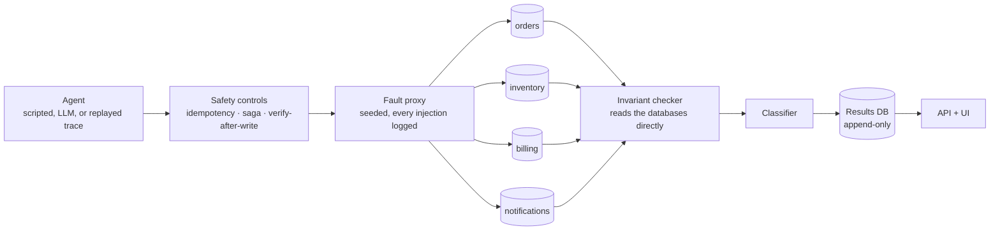
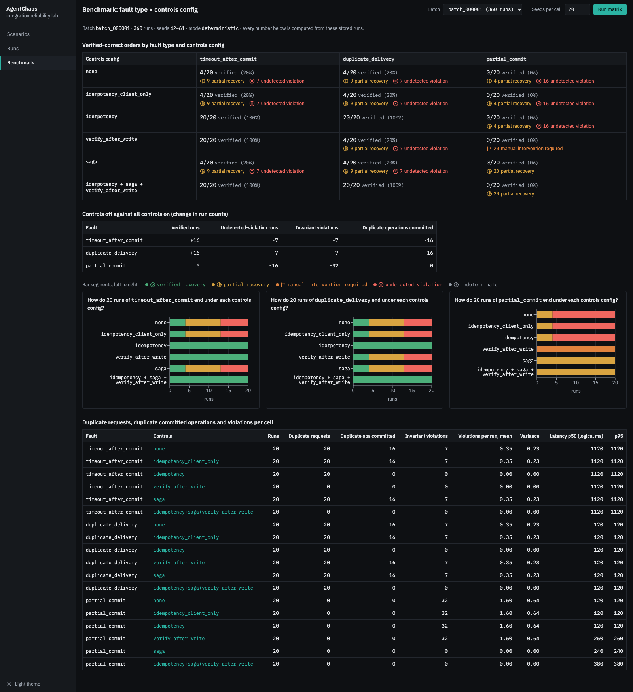

# AgentChaos

**Will your business systems survive an autonomous AI agent?**

AgentChaos is a reliability lab for AI integrations. It runs an agent through an
order workflow, injects the failures real APIs produce, and then checks the
services' databases to see what actually happened. It measures how often
business correctness breaks, and whether three specific safety controls fix it.


The agent above was told `TIMEOUT`, retried, and reported success. The billing
database holds two invoices for one order. Nothing in the run noticed.


## The problem

An agent that calls business APIs treats responses as facts. They are not:

- A timeout can mean the request succeeded.
- A `200` can mean the work is still queued.
- A successful retry can mean the first attempt also went through.

The usual agent behaviour, "it failed, call it again", turns each of these into
duplicate invoices, double-reserved stock or orders left half done. The agent's
own account of the run does not show it.

## What it does

One workflow: create order → reserve inventory → create invoice → confirm order → notify.



- **Mock services.** Four FastAPI apps, each with its own SQLite database, with
  switchable flaws: idempotency keys ignored, duplicates accepted, and async
  commit (answers `202` before anything is stored).
- **Fault proxy.** Three faults, chosen and placed by a seeded RNG:
  - `timeout_after_commit`: the request commits, the response is lost.
  - `duplicate_delivery`: the request is delivered twice, the agent sees one response.
  - `partial_commit`: earlier steps commit, then the next service is down for every attempt.
- **Ground truth.** After every run, five invariants are checked against the
  databases, never against API responses.
- **Safety controls,** toggled per run:
  - *Idempotency keys*, with a client-side dedupe store and server-side support in the mocks.
  - *Saga*: on failure, compensate completed steps in reverse order.
  - *Verify-after-write*: after a timeout or 5xx, query actual state before retrying.
- **Results.** Every run is stored in an append-only database. UPDATE and DELETE
  are rejected by triggers. Every number in the UI and in this README is
  computed from stored runs.

### How a run is judged

Execution state and classification are separate.

| Execution state | Meaning |
|---|---|
| `running` → `resolved` | The final state was read from the databases. |
| `pending_reconciliation` | A service accepted a write it has not committed yet. Bounded, logged attempts follow. |
| `indeterminate` | Still unknown after the bounded attempts. Reported as its own category and never classified. |

| Classification (resolved runs only) | Meaning |
|---|---|
| `verified_recovery` | Order confirmed, every invariant holds, no duplicate operation committed. |
| `partial_recovery` | Invariants hold, but the order was not fulfilled, or a duplicate side effect was left behind. |
| `manual_intervention_required` | A control checked actual state and escalated to a person. Never counted as a success. |
| `undetected_violation` | An invariant is violated and nothing in the run detected it. |

## Results

Deterministic mode, scripted naive-retry agent, 20 seeds (42–61) per cell,
360 runs. Reproduce with `make bench`; the same seeds give the same numbers.

Runs ending `verified_recovery`, out of 20:

| Controls | `timeout_after_commit` | `duplicate_delivery` | `partial_commit` |
|---|---|---|---|
| none | 4 | 4 | 0 |
| idempotency keys, server ignores them | 4 | 4 | 0 |
| idempotency keys, server honours them | **20** | **20** | 0 |
| verify-after-write | **20** | 4 | 0 |
| saga | 4 | 4 | 0 |
| all three | **20** | **20** | 0 |

Controls off against all three on:

| Fault | Undetected-violation runs | Invariant violations | Duplicate operations committed |
|---|---|---|---|
| `timeout_after_commit` | 7 → 0 | 7 → 0 | 16 → 0 |
| `duplicate_delivery` | 7 → 0 | 7 → 0 | 16 → 0 |
| `partial_commit` | 16 → 0 | 32 → 0 | 0 → 0 |



### Every remaining failure, explained

- **Controls off, 4 of 20 still verify under timeout and duplicate faults.**
  In those seeds the fault hit `confirm_order`, which is naturally idempotent:
  confirming a confirmed order changes nothing. The duplicate request still
  reached the service; it is counted under duplicate requests, not duplicate
  committed operations.
- **Controls off, 9 of 20 are `partial_recovery`, not violations.** The fault
  hit `create_order` or `notify_customer`. The duplicate (a stray unconfirmed
  order, or a second notification) breaks none of the five invariants, but it
  is real leftover state, so the run is not reported as a clean recovery.
- **Idempotency keys the server ignores change nothing.** Identical to no
  controls in all three columns. Idempotency needs server cooperation and
  durable state; a client-side store cannot help when the response was lost,
  because the client has nothing to remember.
- **Verify-after-write does not fix `duplicate_delivery` (4 of 20).** The
  duplicate arrives behind a normal `201`, so there is no ambiguous response to
  trigger a check.
- **Saga alone fixes neither timeout nor duplicate faults.** It only acts when
  the workflow fails, and it can only compensate writes the agent knows about.
- **`partial_commit` never reaches `verified_recovery`, with any controls.**
  The service is down for every attempt, so the order cannot complete. What
  changes is how it ends:
  - no controls: 16 `undetected_violation` (reservation and sometimes invoice
    stranded) and 4 `partial_recovery` (the outage hit the first step after
    order creation, leaving only an unconfirmed order);
  - verify-after-write alone: 20 `manual_intervention_required`. It confirms
    from actual state which writes are still live and escalates. The databases
    are still wrong (32 violations); a person has to act;
  - saga: 20 `partial_recovery`. Compensations release the reservation, void
    the invoice and cancel the order. The state is consistent and the order is
    not fulfilled.
- **Compensation is not rollback.** After a saga the original rows still exist,
  marked `released`, `void` and `cancelled`.
- **Indeterminate runs: 0 in this benchmark.** The async flaw is off in the
  matrix. With it on and a commit slower than the reconciliation budget, a run
  ends `indeterminate` and is never classified (covered by tests).

## Live LLM agent

Live mode runs a real tool-calling model against the same proxy and controls.
One OpenAI-compatible client covers every provider; the first provider with a
key in `.env` is used (Groq by default), with a local Ollama as fallback.

```
AGENTCHAOS_LIVE_MODE_ENABLED=true   # in .env, plus one provider key
make live RUNS=3
```

**No live results are published here yet.** Live runs need a provider key and
none has been configured in this checkout. The live agent, provider client and
trace replay are tested against a scripted stand-in model only. When live runs
exist they will be reported per model as "smoke test, n=K, not statistically
meaningful".

Every live run saves its tool-call trace to `data/traces/`. A trace can be
replayed without an LLM, with different controls:

```
uv run python -m agentchaos.live replay data/traces/run_000123.json --controls all
```

Cost is two fields: `billed_cost_usd` (what was charged; 0 on a free tier) and
`estimated_cost_usd` (tokens at the public list price, or unknown if no price
is configured in `providers.yaml`).

## Run it

```
cp .env.example .env
docker compose up --build     # UI and API on http://localhost:8100
make setup                    # uv sync, npm ci, gitleaks pre-commit hook
make bench                    # the 360-run matrix above
make test                     # ruff, mypy, pytest, eslint, design lint, tsc, vitest
make e2e                      # Playwright against a real benchmark; refreshes screenshots
```

Needs Python 3.12, [uv](https://docs.astral.sh/uv/), Node 22 and Docker.

## Limitations

- **One workflow, three faults, mock services.** The numbers describe this
  workflow under these faults. They are not rates for any real system.
- **The deterministic agent is a scripted naive-retry policy,** not an LLM. It
  models one common behaviour. Real models may verify, give up or improvise.
- **Variation across seeds comes from which step the fault hits** and the order
  contents. Within one (fault, step, controls) combination the outcome is fixed.
- **Latency in deterministic mode is logical time** (20 ms per call, 1000 ms
  per timeout), not measured latency.
- **Verify-after-write depends on a read endpoint that reflects the write.** A
  service with a lagging read path would defeat it.
- **Trace replay adjusts recorded decisions** when controls differ from the
  recording: ids come from the current run, and a recorded retry is skipped if
  the call it retried succeeded this time. Each skip is logged as an event.
- **Not built:** multi-provider routing and failover, OpenTelemetry/Jaeger,
  the Providers, Invariants and Settings screens, keyboard shortcuts.
- **CI has not run on GitHub yet.** The workflow is in the repo; nothing has
  been pushed.

Design choices are logged in [DECISIONS.md](DECISIONS.md); the UI review is in
[DESIGN_REVIEW.md](DESIGN_REVIEW.md).
